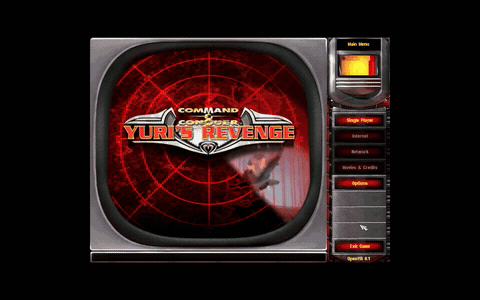
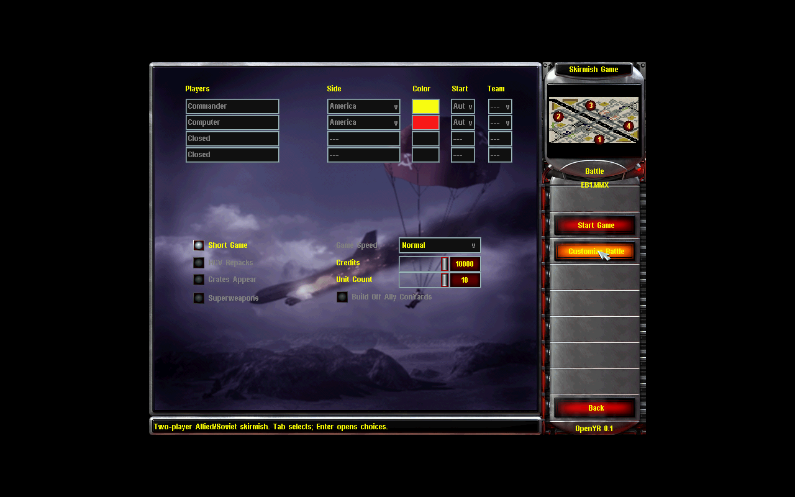
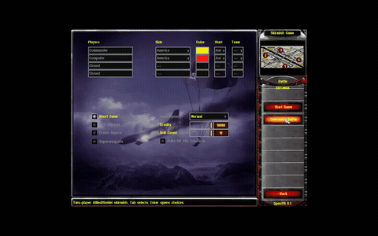
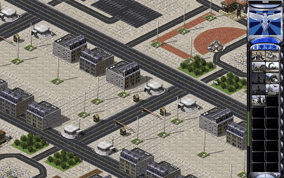
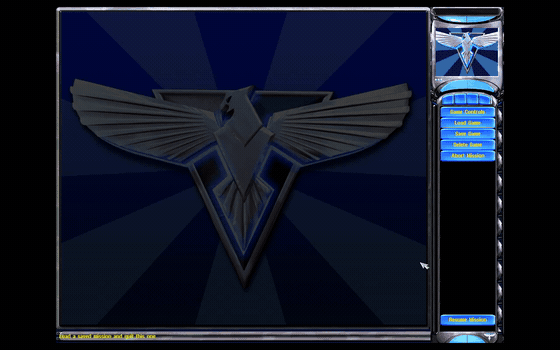

# OpenYR

[](https://github.com/johnnyhuy/openyr/actions/workflows/ci.yml)

A native Rust rewrite of **Command & Conquer: Red Alert 2: Yuri's Revenge**,
with macOS as the primary target. OpenYR reads data from your legally owned game
install. It is a pre-alpha playable sandbox; full game and visual parity are
still in progress.

[Project website](https://johnnyhuy.github.io/openyr/) / [Source ZIP](https://github.com/johnnyhuy/openyr/archive/refs/heads/main.zip)

## Features

| Feature | In game | Preview |
| --- | --- | --- |
| Main menu | Animated retail shell, Single Player, settings and return from a match. |  |
| Skirmish setup | Installed map catalog, two participants, nine Allied/Soviet countries, colors, start positions, teams, credits, starting units and speed. |  |
| Match loading | Country artwork, selected-map preview, progress and cancellation before entering the battlefield. |  |
| Battlefield | Retail terrain, SHP/VXL units and building animations, with camera pan, zoom and optional edge scrolling. |  |
| Saved matches | Named save/load/delete, F5/F9, overwrite confirmation, recovery and Ctrl/Command+A name editing. |  |

| System | Implemented behavior |
| --- | --- |
| Selection and orders | Click/box selection, control groups, attack-move, contextual cursors, target brackets and order feedback. |
| Combat and economy | Deterministic movement, weapon damage, harvesting, owner credits and basic skirmish AI. |
| Production and structures | Unit/building queues, hold/resume/cancel, READY placement, repair and sell. |
| Sidebar | Retail cameos, per-category scrolling, powered radar and a live power meter. |
| Audio | Theme music, unit voices, weapon reports, EVA, mute and device recovery. |
| Saves | Compatibility checks, atomic writes, saved setup restoration and visible success/error feedback. |

Superweapon activation, country special abilities, broader game modes, original
AI and remaining effects are unfinished. Original animation timing and physical
Mac/Retina input verification also remain open. EB1.MMX is the main regression
map; addon and roguelite work follow the core playable baseline. See the
[roadmap](docs/roadmap.md) and [menu observations](docs/formats/front-menu.md).

## Build and launch

Use [mise](https://mise.jdx.dev/getting-started.html) to install the project tools.
Rust follows `rust-toolchain.toml` (stable with `rustfmt`, `clippy` and LLVM tools);
`mise.toml` selects Python 3.13 and defines the development tasks. Git is also
required. Linux contributors also need
`pkg-config` and ALSA development headers, such as `libasound2-dev` on Debian/Ubuntu.
A desktop display is needed for the interactive window; headless runs can use
`--ticks` or `--frames`.

```sh
mise trust
mise install
mise run build
OPENYR_GAMEDIR="/path/to/RA2" mise run run
```

Launch without game arguments to open the main menu. `OPENYR_GAMEDIR` selects
an install explicitly. On macOS, OpenYR also discovers the usual
`~/Games/RA2YR/prefix/drive_c/Westwood/RA2` location or offers a folder picker and
remembers your choice. Select the game-data folder containing the MIX archives,
not the Windows executable. See [game-data discovery and packaging](docs/macos-app.md).

On macOS, build a Finder-launchable app:

```sh
mise run package
open target/OpenYR.app
```

For later launches, double-click the app. Its package contains the engine and
launcher; it reads your game data from the selected install.

Start the EB1 sandbox directly with explicit arguments:

```sh
mise run run -- "/path/to/RA2" EB1.MMX
```

The workspace defaults to `yr-app`. Use `-p mix-dump` for asset inspection or
`-p sim-bench` for the simulation benchmark.

## Controls and saved matches

| Input | Action |
| --- | --- |
| Left-click / drag | Select units or box-select; click a destination/target to order selected units |
| Right-click | Cancel the current mode or selection |
| Right-drag / arrow keys | Pan the camera |
| Mouse wheel | Zoom the world; scroll lists/sidebar where applicable |
| Ctrl+1-9 / 1-9 | Assign / recall a team; Shift+number adds it, double recall centers the camera |
| A, then click / Ctrl+Shift+click | Attack-move |
| T | Expand selection to visible owned units of matching types |
| H | Center the camera on an owned construction yard |
| S / Ctrl+H | Stop / harvest with eligible selected units |
| Q / W / E / R | Structures / defences / infantry / vehicles tab |
| K / L | Repair / sell mode |
| M | Toggle mute |
| Escape | Cancel an active command, then open Pause |
| F5 / F9 | Save / confirm loading the active quicksave target |
| Ctrl+A / Command+A in name fields | Select the whole save/player name for replacement |

Left-click a sidebar item to build, resume held work or pick up a READY structure.
Right-click holds production; a second right-click cancels it. Menus pause the
simulation without catch-up on resume. Tab selects controls, and arrows navigate
saved-match lists. Edge scrolling is optional in Controls.

Pause provides named saves, load/delete, restart and return to Main Menu.
Saved matches are also available from Single Player. The default F5/F9 file is
`~/Library/Application Support/OpenYR/quicksave.oyrsave`; loading a named match
makes that file the new target. A successful fresh front-menu Start uses
`quicksave.oyrsave` in the current save folder, protecting the earlier named slot.
In-match restart retains its active target. Successful menu loads confirm the save
name and restored tick. Failures retain the current match with a recovery route.

```sh
mise run run -- "/path/to/RA2" EB1.MMX --ticks 900 --save /tmp/match.oyrsave
mise run run -- "/path/to/RA2" EB1.MMX --load /tmp/match.oyrsave --ticks 3000
mise run run -- "/path/to/RA2" EB1.MMX --load /tmp/match.oyrsave
```

Ticks are absolute: the second command resumes the saved state through tick 3000.
`--save` without ticks writes the starting state headlessly. Explicit CLI launches
bypass the front menu. Keep saves outside Git because they contain retail-derived
data. See [save compatibility](docs/formats/save.md), [menu behavior](docs/formats/menus.md)
and [team controls](docs/control-groups.md).

## Development and proof

```sh
mise run check
```

`mise tasks` lists individual build, run, test, clippy, fmt, proof and packaging
tasks. `check` runs formatting, Clippy, workspace tests and proof-helper tests.
CI uses the same mise configuration and tasks. For ad hoc commands, use
`mise exec -- cargo ...` or activate mise in your shell; direct Cargo commands
remain supported through `rust-toolchain.toml`. Keep local paths and credentials
out of the shared configuration.

Retail tests use `~/Games/RA2YR/prefix/drive_c/Westwood/RA2` when available and
self-skip without it. CI checks the code on macOS without retail data; that is
separate from physical Mac, Retina or audio-device verification.

For runtime proof, commit your source and use a new isolated output directory:

```sh
mise run proof:build -- --output .tmp/proof-build-001
mise run proof:run -- --receipt .tmp/proof-build-001/receipt.json -- \
  "/path/to/RA2" EB1.MMX --frames /tmp/openyr-proof 300 900 1500
```

The helper records source and executable hashes and refuses changed artifacts.
This avoids stale executables from shared Cargo target directories. Frame exports
include PNGs, `audio.wav` and `audio-cues.tsv`; keep retail-derived outputs outside
Git. [Runtime proof instructions](docs/runtime-proof.md) and [contributor rules](AGENTS.md)
cover verification and publishing evidence.

Inspect your own assets with `mix-dump`:

```sh
mise exec -- cargo run --locked -p mix-dump -- list "/path/to/RA2/langmd.mix"
mise exec -- cargo run --locked -p mix-dump -- rules "/path/to/RA2" NukeSpecial
mise exec -- cargo run --release --locked -p mix-dump -- scan /path/to/RA2/*.mix
```

## Repository layout

| Path | Purpose |
| --- | --- |
| `crates/yr-formats` | Bounded format parsing |
| `crates/yr-assets` | Game-install VFS and archive lookup |
| `crates/yr-rules` | Typed rules and supporting game data |
| `crates/yr-sim` | Deterministic integer simulation |
| `crates/yr-render` | Retail map and object rendering |
| `crates/yr-app` | Native window, menus, input, audio and match flow |
| `tools/` | Inspection and simulation tools |
| `docs/` | Architecture, roadmap, format observations and research |

## License and game content

OpenYR is an independent, unofficial project, unaffiliated with and not endorsed
by Electronic Arts or Westwood Studios. Red Alert 2 and Yuri's Revenge were not
part of EA's 2025 source-code release. This project implements a new native
engine; it does not distribute the original game's source or executable code.

| Part | License and ownership |
| --- | --- |
| OpenYR engine | [GNU GPLv3](LICENSE). The engine's source license does not grant rights to the original game content. |
| Game data | Original artwork, music, voices, maps, rules and other retail files remain the property of their respective rights holders. Supply your own legally owned install; these files are not bundled. |
| Screenshots and GIFs | Illustrations of OpenYR using retail data, hosted separately from the merged source tree. Depicted game content retains its original ownership and is not relicensed under the engine's GPL. |
| Implementation method | Clean-room work based on documented asset formats and public behavior observations. No original executable implementation or process-memory copying, and no transplanted code from YRpp, Phobos, Ares or XCC. |

The project takes other C&C reimplementations as engineering precedents, not as
permission from a rights holder. See the [legal context and precedents](docs/legal.md),
[dependency licenses](docs/third-party.md), [architecture](docs/architecture.md)
and [capture provenance](docs/demos.md).
