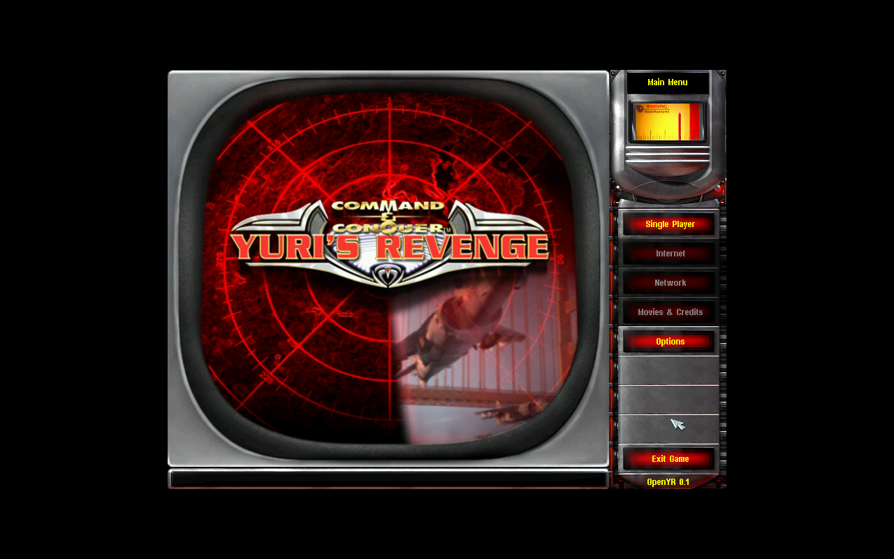
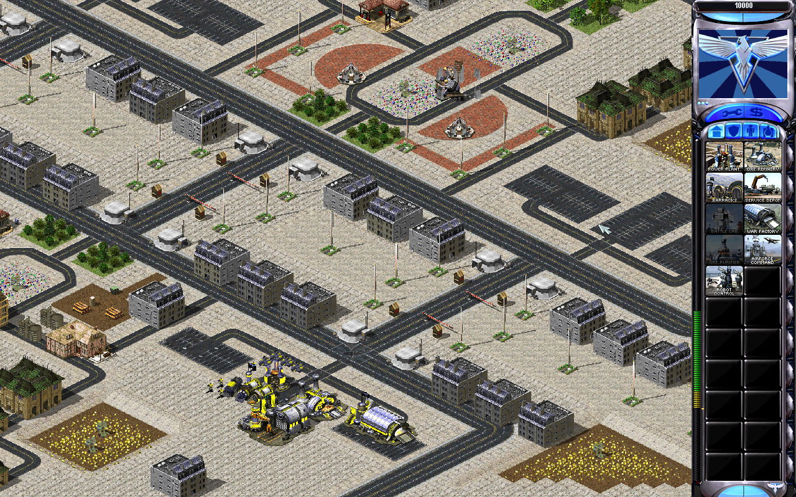

# OpenYR

[](https://github.com/johnnyhuy/openyr/actions/workflows/ci.yml)

A native Rust rewrite of **Command & Conquer: Red Alert 2: Yuri's Revenge**, with
macOS as the primary target. OpenYR reads the original Westwood game data from
your legally owned install. No EA assets or original executable code are included.

OpenYR is a **pre-alpha playable sandbox**. The native menu and match flow work,
but original-game parity and the full game rules are still in progress. See the
[roadmap](docs/roadmap.md) for verified slices and remaining work.

## See it run

Native OpenYR with retail data, captured at 1280x800 on Linux. Click either
video link to watch the recorded flow.

[Watch menu, Skirmish and loading (24 seconds)](https://github.com/johnnyhuy/openyr/blob/c7deba4c12ab133026c00570e4a2c78d7fa3fa65/proof/native-demo/start-flow.mp4?raw=true)
| [Watch world zoom and pause/resume (12 seconds)](https://github.com/johnnyhuy/openyr/blob/c7deba4c12ab133026c00570e4a2c78d7fa3fa65/proof/native-demo/match-pause.mp4?raw=true)





[Skirmish setup](https://github.com/johnnyhuy/openyr/blob/c7deba4c12ab133026c00570e4a2c78d7fa3fa65/proof/native-demo/skirmish.png) | [Loading screen](https://github.com/johnnyhuy/openyr/blob/c7deba4c12ab133026c00570e4a2c78d7fa3fa65/proof/native-demo/loading.png)
| [Pause menu](https://github.com/johnnyhuy/openyr/blob/c7deba4c12ab133026c00570e4a2c78d7fa3fa65/proof/native-demo/pause.png) | [Full recording and capture receipt](https://github.com/johnnyhuy/openyr/blob/c7deba4c12ab133026c00570e4a2c78d7fa3fa65/proof/native-demo)

These demos show source `11379ae`, including the engine from PR #244. Video is
silent; no physical Mac, Retina or audio-device check was performed. Captures
show OpenYR's current behavior and do not establish original-game timing parity.
Derived media is pinned separately from the source tree; running the game still
requires your own install. See [recording and provenance](docs/demos.md).

## What works

| Area | Current implementation |
| --- | --- |
| Menus | Animated main menu, Single Player, Battle map chooser, saved matches, options, loading and recovery |
| Match setup | Two participants, nine Allied/Soviet countries, colors, authored starts, opposing teams, Short Game and speed presets |
| World interaction | Selection, control groups, camera pan/zoom, optional edge scrolling, contextual cursors and order feedback |
| Simulation | Deterministic movement, combat, harvesting, economy, production, structure placement, repair/sell and basic skirmish AI |
| Saves | Named save/load/delete, F5/F9, compatibility checks, atomic writes and visible recovery; long save-name edits keep the caret visible |
| Rendering | Retail terrain, SHP/VXL units, building/infantry animation and an expanding set of combat effects |
| Audio | Theme music, voices, weapon reports and EVA; device recovery and mute controls |
| Data tools | MIX/VFS, strings, rules, images, models and audio inspection; typed superweapon and sound-event definitions |

The chooser uses the installed map catalog; gameplay remains a limited sandbox.
EB1.MMX is the main regression/demo map. Superweapon charging/firing, country
special abilities, broader modes and original AI behavior remain unfinished.
Original menu/animation timing, full effects and physical macOS/Retina input
verification also remain open. Addon packs and roguelite work follow the core
playable baseline. [Known limits and observations](docs/formats/front-menu.md).

## Build and launch

Use [mise](https://mise.jdx.dev/getting-started.html) to install the project tools.
Rust follows `rust-toolchain.toml` (stable with `rustfmt`, `clippy` and LLVM tools);
`mise.toml` selects Python 3.13 and defines the development tasks. Git is also
required. Linux contributors also need
`pkg-config` and ALSA development headers, such as `libasound2-dev` on Debian/Ubuntu.
A desktop display is needed for the interactive window; headless runs can use
`--ticks` or `--frames`.

```sh
mise trust
mise install
mise run build
OPENYR_GAMEDIR="/path/to/RA2" mise run run
```

Launch without game arguments to open the main menu. `OPENYR_GAMEDIR` selects
an install explicitly. On macOS, OpenYR also discovers the usual
`~/Games/RA2YR/prefix/drive_c/Westwood/RA2` location or offers a folder picker and
remembers your choice. Select the game-data folder containing the MIX archives,
not the Windows executable. See [game-data discovery and packaging](docs/macos-app.md).

On macOS, build a Finder-launchable app:

```sh
mise run package
open target/OpenYR.app
```

For later launches, double-click the app. Its package contains the engine and
launcher; it reads your game data from the selected install.

Start the EB1 sandbox directly with explicit arguments:

```sh
mise run run -- "/path/to/RA2" EB1.MMX
```

The workspace defaults to `yr-app`. Use `-p mix-dump` for asset inspection or
`-p sim-bench` for the simulation benchmark.

## Controls and saved matches

| Input | Action |
| --- | --- |
| Left-click / drag | Select units or box-select; click a destination/target to order selected units |
| Right-click | Cancel the current mode or selection |
| Right-drag / arrow keys | Pan the camera |
| Mouse wheel | Zoom the world; scroll lists/sidebar where applicable |
| Ctrl+1-9 / 1-9 | Assign / recall a team; Shift+number adds it, double recall centers the camera |
| A, then click / Ctrl+Shift+click | Attack-move |
| S / H | Stop / harvest with eligible selected units |
| K / L | Repair / sell mode |
| M | Toggle mute |
| Escape | Cancel an active command, then open Pause |
| F5 / F9 | Save / confirm loading the active quicksave target |

Left-click a sidebar item to build, resume held work or pick up a READY structure.
Right-click holds production; a second right-click cancels it. Menus pause the
simulation without catch-up on resume. Tab selects controls, and arrows navigate
saved-match lists. Edge scrolling is optional in Controls.

Pause provides named saves, load/delete, restart and return to Main Menu.
Saved matches are also available from Single Player. The default F5/F9 file is
`~/Library/Application Support/OpenYR/quicksave.oyrsave`; loading a named match
makes that file the new target. Successful menu loads confirm the save name and
restored tick. Failures retain the current match with a recovery route.

```sh
mise run run -- "/path/to/RA2" EB1.MMX --ticks 900 --save /tmp/match.oyrsave
mise run run -- "/path/to/RA2" EB1.MMX --load /tmp/match.oyrsave --ticks 3000
mise run run -- "/path/to/RA2" EB1.MMX --load /tmp/match.oyrsave
```

Ticks are absolute: the second command resumes the saved state through tick 3000.
`--save` without ticks writes the starting state headlessly. Explicit CLI launches
bypass the front menu. Keep saves outside Git because they contain retail-derived
data. See [save compatibility](docs/formats/save.md), [menu behavior](docs/formats/menus.md)
and [team controls](docs/control-groups.md).

## Development and proof

```sh
mise run check
```

`mise tasks` lists individual build, run, test, clippy, fmt, proof and packaging
tasks. `check` runs formatting, Clippy, workspace tests and proof-helper tests.
CI uses the same mise configuration and tasks. For ad hoc commands, use
`mise exec -- cargo ...` or activate mise in your shell; direct Cargo commands
remain supported through `rust-toolchain.toml`. Keep local paths and credentials
out of the shared configuration.

Retail tests use `~/Games/RA2YR/prefix/drive_c/Westwood/RA2` when available and
self-skip without it. CI checks the code on macOS without retail data; that is
separate from physical Mac, Retina or audio-device verification.

For runtime proof, commit your source and use a new isolated output directory:

```sh
mise run proof:build -- --output .tmp/proof-build-001
mise run proof:run -- --receipt .tmp/proof-build-001/receipt.json -- \
  "/path/to/RA2" EB1.MMX --frames /tmp/openyr-proof 300 900 1500
```

The helper records source and executable hashes and refuses changed artifacts.
This avoids stale executables from shared Cargo target directories. Frame exports
include PNGs, `audio.wav` and `audio-cues.tsv`; keep retail-derived outputs outside
Git. [Runtime proof instructions](docs/runtime-proof.md) and [contributor rules](AGENTS.md)
cover verification and publishing evidence.

Inspect your own assets with `mix-dump`:

```sh
mise exec -- cargo run --locked -p mix-dump -- list "/path/to/RA2/langmd.mix"
mise exec -- cargo run --locked -p mix-dump -- rules "/path/to/RA2" NukeSpecial
mise exec -- cargo run --release --locked -p mix-dump -- scan /path/to/RA2/*.mix
```

## Repository layout

| Path | Purpose |
| --- | --- |
| `crates/yr-formats` | Bounded format parsing |
| `crates/yr-assets` | Game-install VFS and archive lookup |
| `crates/yr-rules` | Typed rules and supporting game data |
| `crates/yr-sim` | Deterministic integer simulation |
| `crates/yr-render` | Retail map and object rendering |
| `crates/yr-app` | Native window, menus, input, audio and match flow |
| `tools/` | Inspection and simulation tools |
| `docs/` | Architecture, roadmap, format observations and research |

## Legal and method

OpenYR uses a clean-room method based on public behavior and supplied asset
formats. See [legal notes](docs/legal.md), [architecture](docs/architecture.md) and
[research](docs/research/). Original game assets, executables and derived captures
belong outside the source tree.
